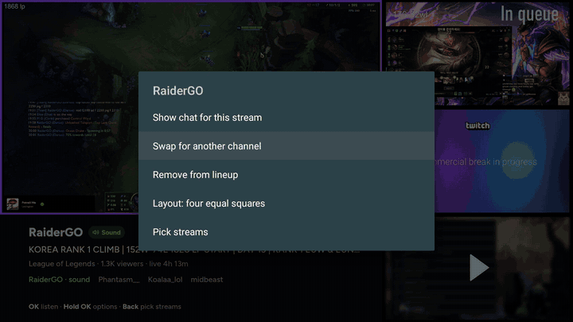
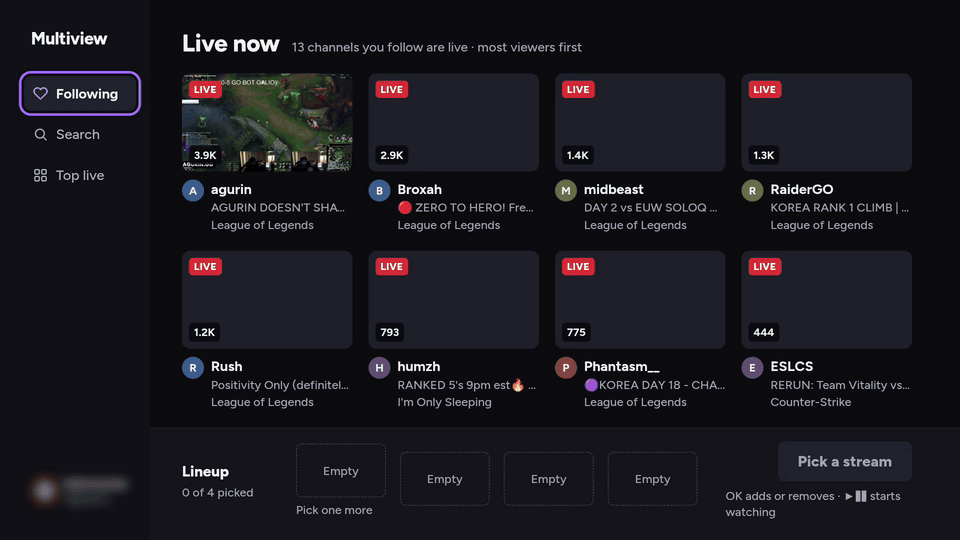
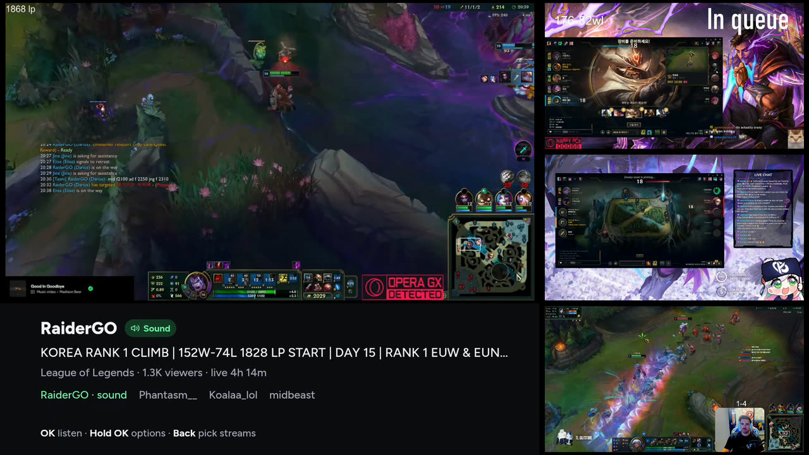
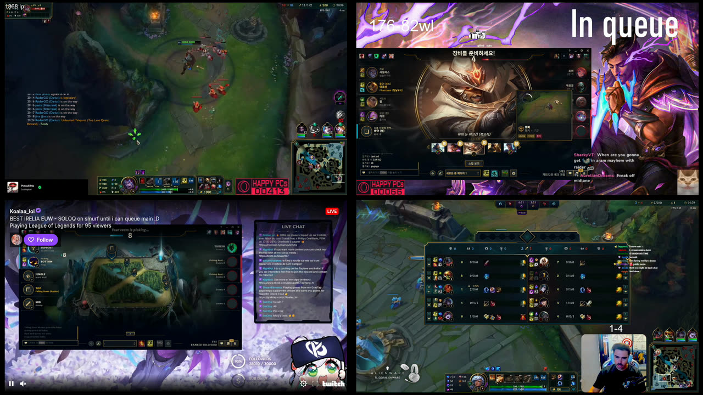
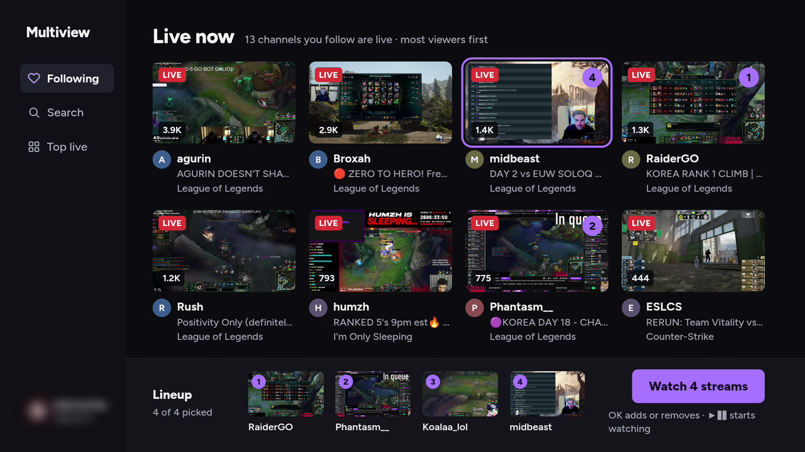
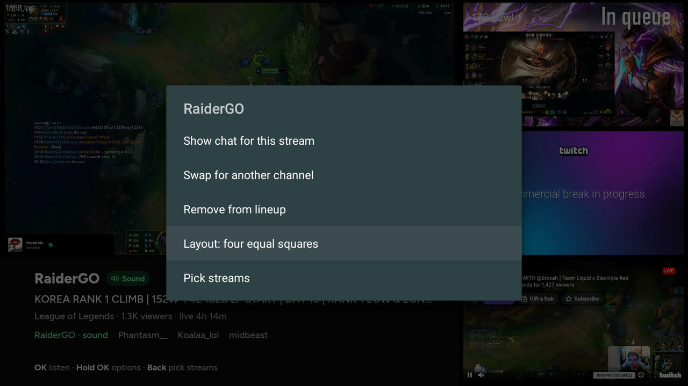

# Multiview for Twitch (Android TV)

Watch up to four live Twitch streams at once on your TV, and choose which one you hear with the remote.

[](https://github.com/Vindi-Van/twitch-multiview/actions/workflows/ci.yml)
[](https://github.com/Vindi-Van/twitch-multiview/releases)
[](LICENSE)

<p align="center">
  
</p>

> [!NOTE]
> Multiview is an unofficial app. It is not affiliated with or endorsed by Twitch Interactive, Inc. Twitch is a trademark of Twitch Interactive, Inc. Streams play in Twitch's official embedded player.

## Features

- **Up to four streams at once,** laid out for how many you're watching:
  - one fills the screen;
  - two sit side by side;
  - three share a 2×2 grid;
  - four open in **focus** (the one you hear is big) or as **four equal squares**.
- **Pick what you hear** with one press of OK. The other streams keep playing, muted.
- **Pick streams like on a TV app:**
  - **Following** shows the channels you follow that are live right now;
  - **Search** finds channels by name (the TV keyboard's mic key works too);
  - **Top live** shows the most-watched streams.
- **Sign in with your phone:** the TV shows a code and a QR code; approve it at twitch.tv/activate.
- **Chat for any stream,** shown in free space next to the video, never on top of it.
- **Optional sign-in to Twitch's player,** so Turbo and your subscriptions apply.

<p align="center">
  
</p>

| Focus | Four equal squares |
|---|---|
|  |  |
| **Following** | **Hold OK on a stream** |
|  |  |

## Requirements

- An Android TV device on **Android 11 or newer**, with an up-to-date Android System WebView.
- **Four streams need a strong device.** It's developed and tested on an **NVIDIA Shield TV (2019)**. On less powerful devices, fewer streams may play smoothly. Reports from other devices are welcome.
- A Twitch account is optional: without one you can still add channels by typing their names.

## Install

Download the APK from the [latest release](https://github.com/Vindi-Van/twitch-multiview/releases/latest), then sideload it with one of these:

<details>
<summary><b>With the Downloader app (no computer needed)</b></summary>

1. On the TV, allow installs from unknown sources for Downloader. On Google TV: Settings → Apps → Security & restrictions → Unknown sources.
2. Install **Downloader by AFTVnews** from the Play Store or Amazon Appstore.
3. In Downloader, open `https://github.com/Vindi-Van/twitch-multiview/releases/latest`, choose the `.apk`, and install it.

</details>

<details>
<summary><b>With adb from a computer</b></summary>

1. On the TV, turn on Developer options, then **Network debugging** (on a Shield: Settings → Device Preferences → Developer options).
2. From the computer:

   ```sh
   adb connect <tv-ip-address>:5555
   adb install -r twitch-multiview-v0.2.0.apk
   ```

</details>

Only download Multiview from this repository's Releases page. To update, install the newer APK the same way; your sign-in and lineup are kept.

### Verify the download

Each release has a `SHA256SUMS` file: `sha256sum -c SHA256SUMS` checks the APK. The signing certificate's SHA-256 fingerprint will be listed here with the first signed release.

## Using it

| Where | Remote | Does |
|---|---|---|
| Watching | D-pad | Highlights a stream (purple frame) |
| | **OK** | Gives the highlighted stream the sound (green frame); in focus it becomes the big one |
| | **Hold OK** | Menu: listen, show or hide its chat, swap the channel, remove it, switch layout |
| | **Back** | Goes to the pick screen |
| Picking | D-pad, **OK** | Moves around Following, Search, Top live and Account; OK adds a stream to the lineup or removes it |
| | **▶❚❚** or *Watch* | Starts watching the lineup |
| | **Back** | Exits |

The first time, Multiview asks you to sign in:
1. **Connect your account:** scan the QR code, or go to twitch.tv/activate and type the code on the screen.
2. **Optionally sign in to Twitch's video player,** so ads follow your Turbo and subscriptions. This is Twitch's own sign-in page: up and down move between the boxes, and OK opens the keyboard.

You can skip both and add channels by name in Search.

## Limitations

- **Four streams at most.** The layouts are built for four, every player has to stay at least 400×300 (Twitch's minimum), and four is already a lot of video for a TV box to decode.
- **Ads play as usual,** unless you've signed in to the video player and have Turbo or subscribe to the channel.
- **Only Twitch, for now.** YouTube is planned; see the [roadmap](docs/ROADMAP.md). Copy-protected services such as Peacock or Paramount+ won't play inside a WebView, which only gets software-level DRM.
- **Chat is read-only on the TV.**

## Build from source

Prerequisites: JDK 21, the Android SDK (platform 36), and Node.js 22+ for the page's tests.

```sh
git clone https://github.com/Vindi-Van/twitch-multiview.git
cd twitch-multiview
./gradlew assembleDebug        # → app/build/outputs/apk/debug/app-debug.apk
```

For sign-in, Following and Search, register your own Twitch app:
1. Go to [dev.twitch.tv/console/apps](https://dev.twitch.tv/console/apps) and register an app. Client type: **Public**. OAuth redirect: `http://localhost`.
2. Add its Client ID to `local.properties`:

   ```properties
   twitch.clientId=your_client_id
   ```

Release APKs get the maintainer's Client ID from CI, so it isn't in the repository. Without one, the app still builds and plays streams; sign-in is just turned off.

More in [CONTRIBUTING.md](CONTRIBUTING.md): running on a TV, debugging, tests and lint.

## How it works

One fullscreen WebView shows a page bundled in the app, and that page holds up to four of Twitch's embedded players. The Kotlin side handles the remote, the Twitch account (sign-in with a code, tokens) and native menus. Only the app's own page can talk to it.

[docs/ARCHITECTURE.md](docs/ARCHITECTURE.md) explains the design, and the rules learned the hard way on real TVs: why nothing may sit on top of a player, and why the app never changes stream quality.

## Contributing

Issues and pull requests are welcome; see [CONTRIBUTING.md](CONTRIBUTING.md) and the [Code of Conduct](CODE_OF_CONDUCT.md). What's planned next is in the [roadmap](docs/ROADMAP.md). Please report security problems privately ([SECURITY.md](SECURITY.md)). What the app stores and who it talks to is in [PRIVACY.md](PRIVACY.md).

## License

[MIT](LICENSE) © 2026 Vindi Vantovic

Includes [QR Code Generator for JavaScript](https://github.com/kazuhikoarase/qrcode-generator) by Kazuhiko Arase (MIT). "QR Code" is a registered trademark of DENSO WAVE INCORPORATED. The interface uses the Figtree and JetBrains Mono fonts (SIL Open Font License), loaded from Google Fonts.
